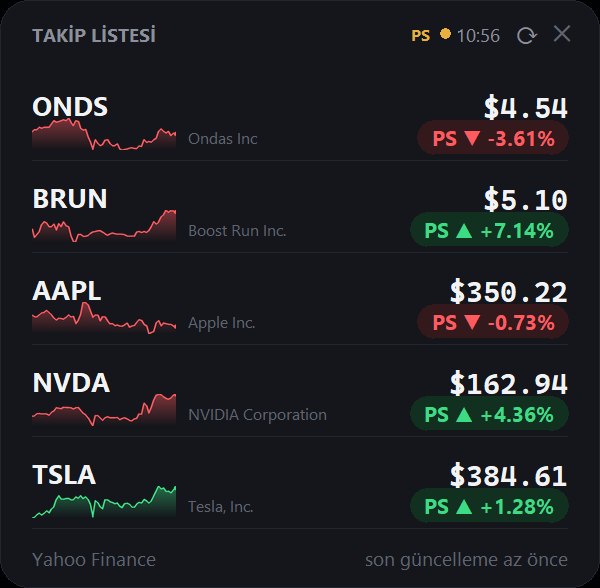
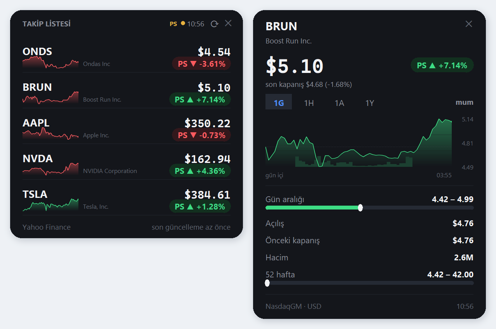

# StockWidget

Windows masaüstünde köşede duran, her zaman üstte kalan küçük bir hisse takip
widget'ı. Python + Tkinter; veri Yahoo Finance'in ücretsiz chart endpoint'inden
gelir. API anahtarı, hesap, abonelik gerekmez.



Fiyat, günlük değişim, mini grafik, portföy ve zaman aralıklı detay grafiği tek
pencerede. Arayüz Türkçe.



## İndir

| Ne | Kim için | Dosya |
|---|---|---|
| **Kurulum paketi** (önerilen) | Herkes | [Releases](https://github.com/ArifKemal/StockWidget/releases/latest) → `StockWidget-<sürüm>-setup.exe` |
| **Portatif ZIP** | Kurulum istemeyen | `StockWidget-<sürüm>-portable.zip` |
| **Kaynak** | Python bilen | `git clone` + `pip install -r requirements.txt` |

Kurulum yönetici hakkı istemez; program kullanıcı hesabına kurulur.

- Program: `%LOCALAPPDATA%\Programs\StockWidget`
- Ayarlar ve log: `%APPDATA%\StockWidget`
- Kaldırma: Başlat menüsü → **StockWidget kaldır** (ayarlar korunur)

> **SmartScreen uyarısı.** Dosyalar kod imzalı değil. "Windows korumalı bilgisayarınızı
> korudu" penceresinde **Ek bilgi → Yine de çalıştır** deyin. Kaynak koddan kendiniz
> derlerseniz uyarı çıkmaz. İmzalama durumu ve ücretsiz SignPath başvuru adımları:
> [docs/imzalama.md](docs/imzalama.md).

### Portatif kullanım

ZIP'i bir klasöre açıp `StockWidget.exe` dosyasını çalıştırın. ZIP kökünde
`README.md`, `LICENSE` ve `docs/` ekran görüntüleri de bulunur; çevrimdışıyken de
dokümana erişebilirsiniz. Varsayılan olarak ayarlar yine `%APPDATA%\StockWidget`
altında tutulur. Gerçek portatif davranış (ayarların exe yanında kalması) için:

```powershell
$env:SW_DATA_DIR = "$PWD\veri"
.\StockWidget.exe
```

## Neler var

**Kart.** Her satırda sembol, fiyat, günlük yüzde rozeti (▲/▼), şirket adı ve
anti-aliased gün içi mini grafik. Fiyatlar tabular (eşit genişlikli) yazı tipinde
olduğu için rakam değişince satır sağa sola zıplamıyor. Altta "son güncelleme 3 dk
önce" gibi göreli zaman, üstte durum noktası: yeşil = piyasa açık, gri = kapalı,
amber = çevrimdışı.

**Detay paneli.** Satıra tıkla. Fiyat, gün aralığı, açılış, önceki kapanış, hacim,
52 hafta aralığı ve büyük grafik. Grafikte **1G / 1H / 1A / 1Y** sekmeleri, sağda
fiyat ekseni, sekme satırının sağında **mum / çizgi** düğmesi. Çizgi modunda
grafiğin alt bandında hacim çubukları görünür. Fareyle grafiğin üzerinde
gezindiğinde dikey imleç, seviye çizgisi ve altta okuma çubuğu çıkar: zaman ·
fiyat · yüzde. Panel aynı satıra tekrar tıklayınca, ✕ ile ya da pencere
gizlenince kapanır.

**Portföy.** Sağ tık > Portföy… Adet ve ortalama maliyet gir; kartın altında
portföy şeridi çıkar: toplam değer ve günlük değişim yüzdesi. Düzenleyici her
satırda canlı değer ve K/Z gösterir, altta toplamı toplar. Satırı boşaltmak
pozisyonu siler. Şerit yalnızca en az bir pozisyon varsa görünür.

**Görünüm.** Sağ tık menüsünden tema (**Gece / Slate / Grafit / Açık**), opaklık
(%80–100) ve yoğunluk (**Normal / Kompakt**) seçilir; hepsi `config.json`'a
yazılır. Kompakt mod satır yüksekliğini 46 → 40 piksele indirir.

**Tepsi ve kısayol.** Widget tepsi simgesinde yaşar; menüsünde göster/gizle,
yenile, semboller, otomatik başlatma ve çıkış var. **Ctrl+Alt+S** her yerden
gösterir/gizler. Sağ üstteki **✕** kapatmaz, tepsiye gizler — tamamen çıkmak için
sağ tık > **Çıkış** ya da tray > **Çıkış**. İkinci kopya açılmaz (adlandırılmış
mutex; sessizce kapanır).

**Dayanıklılık.** Kapalıyken saatte bir, açıkken 15 dakikada bir yeniler. NYSE
resmi tatillerini (2022+ Juneteenth dahil) kapalı sayar. İnternet gidince son
fiyatlar soluklaşır, 90 saniyede bir tekrar dener; 429 gelirse 5 dakika bekler.
Sembol eklerken doğrulama arka planda yapılır, arayüz donmaz. Hatalar `sw.log`
dosyasına yazılır.

## Kullanma

- Taşımak için kartın herhangi bir yerinden sürükle; konum hatırlanır.
- Sembol ekle/çıkar: sağ tık > **Sembol ekle / çıkar…**. Ticker önce Yahoo'dan
  doğrulanır; bulunamazsa hata dialog içinde gösterilir. Hızlı çıkarmak için
  sağ tık > **Hızlı çıkar** > sembol.
- Detay: satıra **tek tıkla**; kapatmak için aynı satıra tekrar tıkla ya da
  paneldeki ✕.
- Grafik aralığı: **1G / 1H / 1A / 1Y** sekmeleri (gün, hafta, ay, yıl).
- Çizim türü: sekme satırının sağındaki **mum** / **çizgi** yazısı.
- Fareyle grafiğin üstünde gez: zaman, fiyat ve yüzde okuması.
- Portföy: sağ tık > **Portföy…** > adet + ortalama > **Kaydet**. Boş satır
  pozisyonu kaldırır; virgüllü ondalık (`12,5`) da kabul edilir.
- Tema / opaklık / yoğunluk: sağ tık alt menüleri. Seçim anında uygulanır ve
  kaydedilir.

### Aç / kapa

| Ne | Nasıl |
|---|---|
| Aç (kurulu) | Başlat menüsü / masaüstü kısayolu |
| Göster / gizle | **Ctrl+Alt+S**, tray menüsü, karttaki **✕** |
| Tamamen çık | Sağ tık > **Çıkış**, tray > **Çıkış** |
| Sessiz çıkış (komut) | `StockWidget.exe --quit` |
| Sürüm | `StockWidget.exe --version` |
| Ayar/log yolu | `StockWidget.exe --paths` |

`--toggle` çalışan kopyayı gösterir/gizler; `--quit` temiz çıkış yapar. Kısayol
komutları kurulum ve kaldırma sırasında da kullanılır.

## Veri kaynağı ve istek disiplini

Yahoo'nun `query1.finance.yahoo.com/v8/finance/chart` endpoint'i kullanılıyor.
Anahtar gerekmiyor ama resmî değil; Yahoo tarafında bir şey değişirse haber
vermeden bozulabilir. Bu yüzden istek sayısı bilinçli olarak düşük tutuluyor.

| Veri | Kaynak | Ek istek |
|---|---|---|
| Fiyat, gün değişimi, satır sparkline'ı | `range=1d&interval=5m` | Yok |
| Gün istatistikleri (yüksek/düşük, hacim, açılış, 52 hafta) | Aynı yanıtın `meta` alanı | Yok |
| **1G** grafiği | Aynı yanıt | Yok |
| **1H** grafiği | `range=5d&interval=15m` | Sekmeye ilk tıklamada 1 |
| **1A** grafiği | `range=1mo&interval=1d` | Sekmeye ilk tıklamada 1 |
| **1Y** grafiği | `range=1y&interval=1d` | Sekmeye ilk tıklamada 1 |

- Sembol başına döngüde **tek istek**, semboller arasında 0,4 s bekleme.
- Sembol eklerken **1 doğrulama isteği** (yalnızca ekleme anında, arka planda).
- Piyasa açıkken 15 dk, kapalıyken 60 dk; hata sonrası 90 s; HTTP 429 → 5 dk.
- 1H / 1A / 1Y sonuçları önbellekte: 15 dk / 1 saat / 1 saat. Aynı panelde
  sekmeler arasında gezinmek ya da paneli kapatıp açmak yeni istek üretmez.
- 5 sembol ≈ günde ~300 istek. Ücretsiz kullanım için rahat.

**Gecikme notu:** Yahoo verisi gecikmeli olabilir; pre/post market yok. Yatırım
kararı için kullanmayın; fiyatlar bilgilendirme amaçlıdır.

## Ayarlar (`config.json`)

Kurulu sürümde `%APPDATA%\StockWidget\config.json`; portatif modda
`SW_DATA_DIR` altında. Örnek:

```json
{
  "symbols": ["AAPL", "MSFT", "NVDA", "GOOGL"],
  "x": 1506,
  "y": 385,
  "theme": "gece",
  "opacity": 0.9,
  "density": "normal",
  "positions": {
    "AAPL": { "qty": 12, "avg": 185.4 }
  }
}
```

| Anahtar | Değer |
|---|---|
| `symbols` | Ticker listesi. Boş/geçersizse varsayılan 5 sembol gelir. |
| `x`, `y` | Kartın sol üst köşesi. Sürükleyince ve çıkışta yazılır. |
| `theme` | `gece`, `slate`, `grafit`, `acik`. Geçersizse `gece`. |
| `opacity` | 0.6 – 1.0 arası; dışındaki değerler kırpılır. Menü 80–100 sunar. |
| `density` | `normal` ya da `compact`. Geçersizse `normal`. |
| `positions` | `{ "SEMBOL": { "qty": adet, "avg": ortalama } }`. Boş olabilir. |

Bozuk bir alan uygulamayı kilitlemez, varsayılana döner. Eski sürümlerin script
yanındaki `config.json` dosyası ilk açılışta `%APPDATA%`'ya bir kez taşınır.

## Geliştirme

### Kaynaktan çalıştırma

```powershell
git clone https://github.com/ArifKemal/StockWidget.git
cd StockWidget
pip install -r requirements.txt
pythonw stock_widget.py
```

`pythonw` konsol açmaz. `pillow` yoksa grafikler daha kaba Tk çizimine düşer;
`pystray` yoksa tepsi simgesi çıkmaz.

### Test

```powershell
python -m py_compile stock_widget.py
python -m unittest test_stock_widget.py
$env:SW_SMOKE="1"; python stock_widget.py   # 12 sn çalışıp kapanır
```

13 birim testi ağa çıkmaz: tatil takvimi, Paskalya, hafta sonu gözlemi, para/hacim
biçimlendirme, renk dönüşümü, metin kısaltma, palet, sparkline, OHLC indirgeme ve
config varsayılanları.

### Paketleme

```powershell
pip install pyinstaller
python tools/bump_version.py 1.0.0
python -m PyInstaller --noconfirm --clean StockWidget.spec
# çıktı: dist\StockWidget\StockWidget.exe  (onedir)

# Kurulum paketi (Inno Setup 6 gerekir)
& "$env:LOCALAPPDATA\Programs\Inno Setup 6\ISCC.exe" "/DMyAppVersion=1.0.0" installer.iss
# çıktı: Output\StockWidget-1.0.0-setup.exe
```

- `StockWidget.spec`: onedir, `--noconsole`, `stock.ico`, sürüm bilgisi.
- `installer.iss`: kullanıcı bazlı kurulum, kısayollar, isteğe bağlı otostart,
  yükseltmede çalışan kopyayı `--quit` ile kapatma, kaldırmada ayarları koruma.
  Ayrıca **ön kontrol** yapar: `{app}` klasörü ve HKCU yazılamıyorsa ham
  "Error 5" yerine ne yapılacağını söyleyen mesaj verip portatif ZIP'i önerir;
  Başlat menüsü/masaüstü yazılamıyorsa kısayolları atlar, kurulumu düşürmez.
- `tools/bump_version.py`: sürümü `stock_widget.py` ve `version_info.txt`'e yazar.
- `tools/screenshot.py`: README görsellerini gerçek uygulamadan üretir.
- `--paths` bayrağı ayar/log dosyasının nerede olduğunu yazdırır.

### CI ve sürüm

- `.github/workflows/ci.yml`: her push/PR'da test + PyInstaller derlemesi.
- `.github/workflows/release.yml`: `v*` etiketi atıldığında test eder, portatif
  ZIP ile kurulum paketini üretir ve GitHub Release'e ekler.

```powershell
git tag v1.0.0
git push origin main --tags
```

Sürüm numarası etiketten alınır; ayrıca elle güncellemek gerekmez.

## Sorun çıkarsa

- **Widget görünmüyor:** Ctrl+Alt+S ya da tray > Göster / Gizle. ✕ sadece gizler.
- **Tepsi ikonu yok:** `pystray` ve `pillow` kurulu mu? Uzak masaüstü/servis
  oturumlarında tepsi erişimi engellenebilir; uygulama yine çalışır.
- **Köşeler keskin / grafikler kaba:** Pillow yok; PIL fallback devrede.
- **Veri gelmiyor:** internet ve Yahoo erişimi. 429 ise 5 dakika bekleyin.
- **Kısayol çalışmıyor:** başka bir uygulama Ctrl+Alt+S'yi kapmış olabilir. Sağ tık
  menüsünde "kaydedilemedi" yazar.
- **Kurulumda dosya kilitli:** çalışan kopyayı kapatın (`StockWidget.exe --quit`)
  ve kurulumu yeniden deneyin.
- **Kurulum "Error 5: Access is denied" diyor:** Makine kurumsal bir politikayla
  kısıtlanmış olabilir (Başlat menüsü, kısayol veya kayıt defteri yazımı engelli).
  Kurulum paketi bunu önceden algılayıp hangi adımın engellendiğini söyler ve
  portatif ZIP'i önerir; yönetici hakkı bu tür kısıtlamayı aşmaz.
- **Kurulum "%TEMP% ... Access is denied" diyor:** `TEMP`/`TMP` klasörü
  yazılamıyor. Kurulumu yazılabilir bir geçici dizinle çalıştırın:
  `set TEMP=C:\Temp&& set TMP=C:\Temp&& StockWidget-1.0.0-setup.exe`
- **Kısayol oluşmadı ama program kuruldu:** Başlat menüsü/masaüstü yazılamamış
  olabilir; kurulum düşmez, uyarı gösterir. Programı doğrudan
  `%LOCALAPPDATA%\Programs\StockWidget\StockWidget.exe` ile açın.
- **Bir şey ters gitti:** `%APPDATA%\StockWidget\sw.log` dosyasına bakın;
  başlangıç, çıkış, fetch hataları ve beklenmeyen istisnalar orada.

## Sınırlar

- Sadece ABD piyasası saatleri ve NYSE tatilleri modellenmiş; BIST/LSE tatilleri
  yok. Başka borsa sembolü ekleseniz bile "açık/kapalı" göstergesi ABD'ye göre
  hesaplanır.
- Pre-market / after-hours fiyatı gösterilmez.
- Portföy K/Z son bilinen fiyatlara göredir; işlem, komisyon, kur ve vergi
  hesaba katılmaz.
- Tk pencere olduğu için gerçek gölge/blur yok; köşe yuvarlatma şeffaf renk
  anahtarıyla yapılıyor.
- Windows 10/11 x64 hedeflenir. macOS/Linux desteklenmez (`winreg`, tepsi ve
  kısayol Windows'a özgü).
- Yahoo endpoint'i resmî değil. En kötü ihtimalle veri kaynağını değiştirmek
  gerekir; istek sınırını aşmamak için önbellek ve aralıklar bilerek muhafazakâr.

## Lisans

MIT — ayrıntılar için [LICENSE](LICENSE). Copyright (c) 2026 Arif Kemal.
