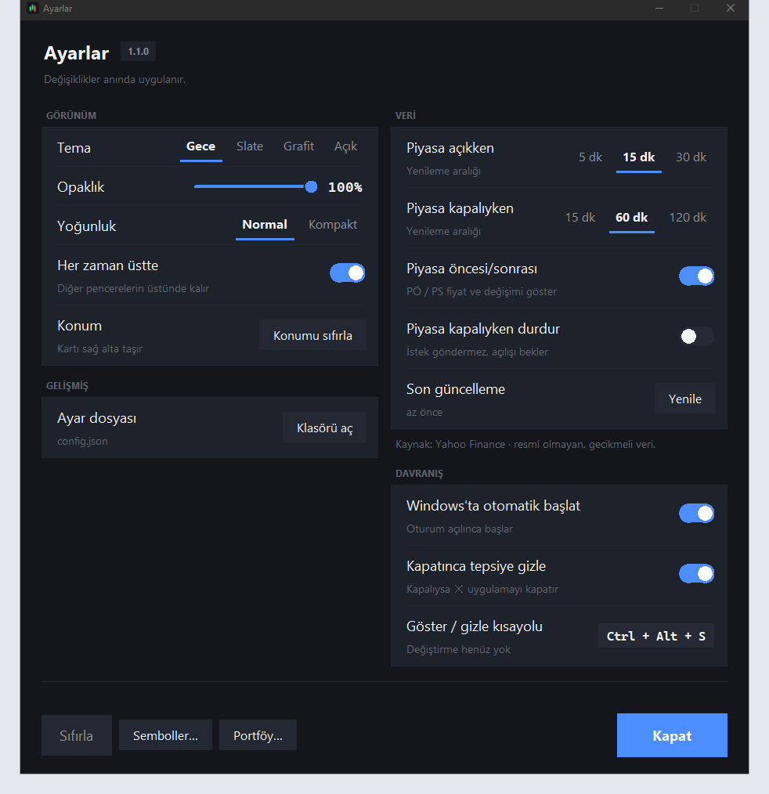

# StockWidget

Windows'ta köşede duran, her zaman üstte kalan küçük bir hisse takip widget'ı.
Python + Tkinter; veri Yahoo Finance'in ücretsiz chart endpoint'inden gelir —
API anahtarı, hesap, abonelik gerekmez. Arayüz Türkçe.

<p align="center">
  
</p>

<p align="center">
  
</p>

## İndir

| Dosya | Ne zaman |
|---|---|
| **`StockWidget-<sürüm>.exe`** | **Önerilen.** İndir, çift tıkla, çalışır. Kurulum yok. |
| `StockWidget-<sürüm>-setup.exe` | Kısayol, otomatik başlatma ve kaldırma girişi istersen. |
| `StockWidget-<sürüm>-portable.zip` | Tek dosya antivirüs tarafından engellenirse (yedek). |

[Releases](https://github.com/ArifKemal/StockWidget/releases/latest) sayfasından
indir. 64-bit Windows 10/11 hedeflenir.

> **SmartScreen:** Dosyalar kod imzalı değil. "Windows korumalı bilgisayarınızı
> korudu" derse **Ek bilgi → Yine de çalıştır** deyin. Kendiniz derlerseniz uyarı
> çıkmaz; imzalama durumu: [docs/imzalama.md](docs/imzalama.md).

## Hızlı başlangıç

1. Exe'yi çalıştır. İlk açılış birkaç saniye sürebilir (tek dosya geçici klasöre açılır).
2. Widget sağ üstte belirir. **Ctrl+Alt+S** her yerden gösterir/gizler.
3. Sağ tık menüsünden sembol, portföy, alarm, sıralama, ayarlar ve çıkış işlemleri yapılır.

Ayarlar ve log `%APPDATA%\StockWidget` altında tutulur. Ayarların exe'nin yanında
kalmasını istersen:

```powershell
$env:SW_DATA_DIR = "$PWD\veri"
.\StockWidget-1.1.0.exe
```

## Özellikler

- **Kart:** fiyat, günlük değişim, şirket adı ve mini grafik. PÖ/PS rozeti
  grafikle aynı fiyatı gösterir; açılışta son fiyatlar önbellekten anında gelir.
- **Detay paneli:** **1G / 1H / 1A / 1Y**, çizgi/mum, hacim ve sağ fiyat ekseni,
  temettü/bölünme işaretleri, hedef/maliyet çizgileri; **Esc** ya da **✕** kapatır.
- **Portföy:** değer, günlük değişim ve pozisyon K/Z; hedef fiyat, not, maliyet,
  para birimi başına toplam, **CSV** ve yerel portföy geçmişi grafiği.
- **Alarm ve düzen:** fiyat, günlük değişim ve maliyete göre kâr/zarar alarmı;
  detay grafiğinde sağ tıkla seviyeden alarm; sessiz saat, erteleme, alarm
  geçmişi; sıralama, gruplar ve odak modu. Sağ tıkta taşıma, kopyalama ve
  Yahoo Finance.
- **Piyasalar:** ABD, BIST ve 7/24 kripto profilleri; BIST tatilleri, ₺ biçimi ve
  çoklu piyasa durumu. PÖ/PS yalnızca ABD borsalarında gösterilir.
- **Görünüm ve tepsi:** Gece / Slate / Grafit / Açık, %60–100 opaklık,
  normal/kompakt, kısa geçişler; **Türkçe/English**, tepsi ve otomatik başlatma.
- **Dayanıklılık:** açıkken 15 dk, kapalıyken 60 dk yenileme; 429’da
  `Retry-After`; tek kopya; günde en fazla bir güncelleme denetimi.
- **Hız:** değişmeyen satır ve mini grafik yeniden çizilmez; disk grafik önbelleği,
  son fiyat önbelleği ve yeniden kullanılan Yahoo bağlantısı.

## Veri kaynağı

`query1.finance.yahoo.com/v8/finance/chart` kullanılır. Resmî olmayan endpoint
olduğu için istek sayısı bilinçli olarak düşük tutulur:

- Fiyat + gün istatistikleri + 1G grafiği + temettü/bölünme: **tek istek**
  (`events=div,splits`). Aynı yanıttaki `marketState`, borsa ve saat dilimi
  okunur. ABD, BIST ve kripto profilleri ayrı seans/tatil kuralları kullanır;
  PÖ/PS yalnızca ABD borsalarında gösterilir. BIST dini bayram tablosu
  `market_calendar.py` içinde tutulur ve yıllık güncellenir.
- Seans dışı fiyat (`includePrePost=true`): aynı yanıttaki son 5 dk barından,
  `prev_close`e göre hesaplanır; ayrı istek yok. 1G penceresi `range=1d` yerine
  açık `period1`/`period2` ile istenir — piyasa öncesi saatlerde Yahoo'nun
  önceki seansa düşmesini engeller.
- 1H / 1A / 1Y: sekmeye ilk tıklamada birer istek; sonra önbellekten (1H: 15 dk,
  1A/1Y: 60 dk). Süre dolunca sekme yeniden açıldığında tazelenir.
- Semboller arasında 0,4 s bekleme; varsayılan aralıklarda 5 sembol ≈ günde
  ~300 istek.

**Gecikme:** Yahoo verisi gecikmeli olabilir; seans dışı fiyatlar düşük
likidite nedeniyle normal seanstan sapabilir. Yatırım kararı için kullanmayın.

## Ayarlar

Sağ tık → **Ayarlar…**: görünüm (tema, opaklık, yoğunluk, her zaman üstte,
konumu sıfırla), veri (yenileme aralıkları, piyasa öncesi/sonrası, kapalıyken
durdur, elle yenile), davranış (otomatik başlat, ✕ davranışı), dil (Türkçe /
English) ve gelişmiş (ayar klasörü, tanılama ZIP'i). Değişiklikler anında
uygulanır; **Sıfırla** yalnızca ayarları varsayılana döndürür (semboller,
portföy ve otomatik başlatma korunur). Pencerenin altından Semboller, Portföy
ve Alarmlar pencereleri açılır.

<p align="center">
  
</p>

`%APPDATA%\StockWidget\config.json` (portatif modda `SW_DATA_DIR` altında).
Bozuk alan uygulamayı kilitlemez, varsayılana döner; dosya hiç okunamazsa
`config.json.bak` yedeğinden kurtarılır. Yazma atomiktir (geçici dosya + yer
değiştirme), böylece yarıda kesilse bile eski ayarlar bozulmaz. Bilinmeyen
anahtarlar korunur; geçersiz sembol/pozisyon satırları sessizce atılır.

| Anahtar | Değer |
|---|---|
| `symbols` | Ticker listesi; boşsa varsayılan 5 sembol; en fazla 20, tekrarsız. |
| `x`, `y` | Kartın konumu; sürükleyince kaydedilir (`null` ise sağ alt köşe). |
| `theme` | `gece`, `slate`, `grafit`, `acik`. |
| `opacity` | 0.6–1.0. |
| `density` | `normal` ya da `compact`. |
| `always_on_top` | `true` / `false`; varsayılan `true`. |
| `refresh_open`, `refresh_closed` | Yenileme aralığı (dakika, 1–1440). |
| `pause_when_closed` | `true` ise hiçbir seans açık değilken istek gönderilmez. |
| `extended_hours` | `true` ise piyasa öncesi/sonrası (**PÖ**/**PS**) verisi gösterilir. |
| `close_to_tray` | `true` ise **✕** tepsiye gizler; `false` ise çıkar. |
| `positions` | `{ "AAPL": { "qty": 12, "avg": 185.4, "target": 210, "note": "uzun vade" } }` |
| `alarms` | `{ "AAPL": { "above": 210, "below": 180, "pct": 5, "profit": 20, "loss": 10, "extended": false } }` |
| `sort_mode` | `manual`, `change`, `symbol` veya `value`. |
| `portfolio_show_cost` | `true` ise kartta değerin yanında maliyet de görünür. |
| `language` | `tr` veya `en` (arayüz; log/CLI değişmez). |
| `quiet_enabled`, `quiet_start`, `quiet_end` | Sessiz saatler (0–23). |
| `focus_mode`, `focus_symbol` | Tek sembol odak modu. |
| `symbol_groups`, `group_filter` | `{ "AAPL": "Teknoloji" }` ve menü filtresi. |

Aynı klasörde `snapshot.json` (son fiyatlar), `update.json` (güncelleme
önbelleği), `portfolio-history.json` (günlük portföy toplamları),
`alarm-history.json` ve `series-cache.json` (grafik önbelleği) tutulur.
Hepsi silinebilir; uygulama yeniden oluşturur. **Ayarlar → Tanılama paketi**
portföy adet/maliyetini gizleyen bir destek ZIP'i üretir.

## Lisans

MIT — ayrıntılar için [LICENSE](LICENSE). Copyright (c) 2026 Arif Kemal.
